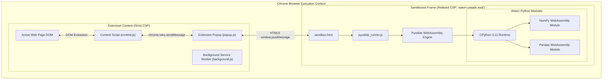
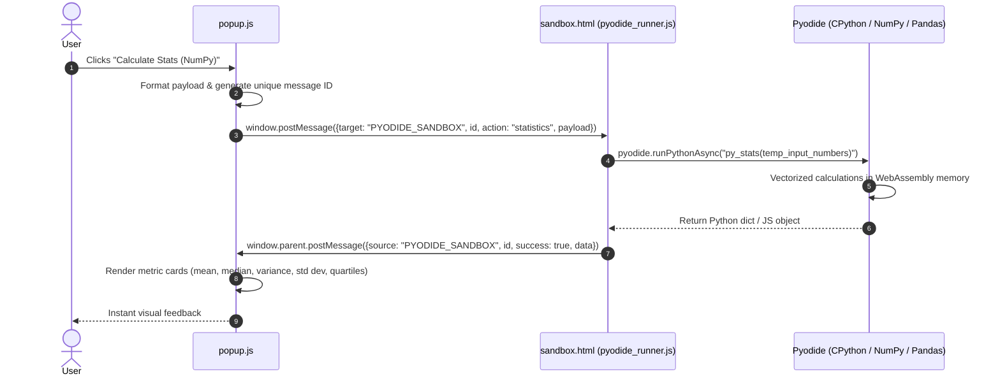

# System Architecture

This document describes the WebAssembly in-browser architecture, execution model, sandboxing, and communication flow.

---

## 🏛️ High-Level WebAssembly Architecture



---

## 🔒 Security Model & Manifest V3 Sandboxing

### The Manifest V3 Challenge

Google Chrome's Manifest V3 enforces a strict Content Security Policy (CSP):

- Extensions cannot execute arbitrary string code or load dynamic remote scripts into their main context.
- Heavy numerical code execution (JIT / Wasm) inside the popup can block the UI thread.

### The Sandboxed Solution

To comply with Manifest V3 while running full CPython:

1. **Dedicated Sandbox Page**:

   ```json
   "sandbox": {
     "pages": ["pyodide/sandbox.html"]
   },
   "content_security_policy": {
     "extension_pages": "script-src 'self' 'wasm-unsafe-eval'; object-src 'self'",
     "sandbox": "sandbox allow-scripts allow-forms; script-src 'self' 'unsafe-eval' 'wasm-unsafe-eval' https://cdn.jsdelivr.net; object-src 'self'"
   }
   ```

2. **Process & Memory Isolation**:
   - `sandbox.html` has no direct access to Chrome Extension APIs (`chrome.tabs`, `chrome.storage`), minimizing attack surfaces.
   - It communicates exclusively via `window.postMessage` with strict `origin` checks.
   - All Python data processing happens in memory on the client's device. No data is transmitted externally.

---

## 🔄 Sequence Diagram: End-to-End Calculation


