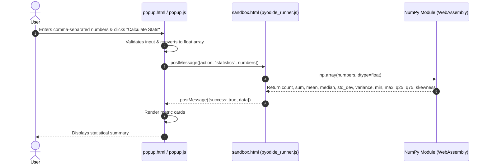
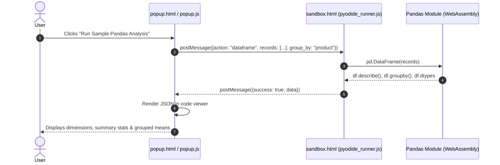
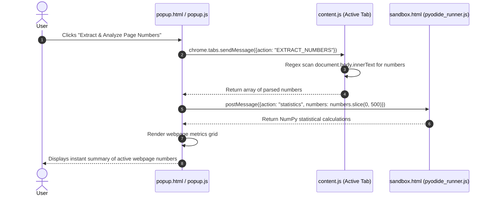

# Functional Details & Workflows

This document details the functional workflows and step-by-step lifecycles of all features in the in-browser Pyodide WebAssembly extension.

---

## 🔄 Workflow 1: NumPy Statistical Computing

---

## 🔄 Workflow 2: Pandas Tabular Analysis

---

## 🔄 Workflow 3: Webpage Data Scraping & Analysis

